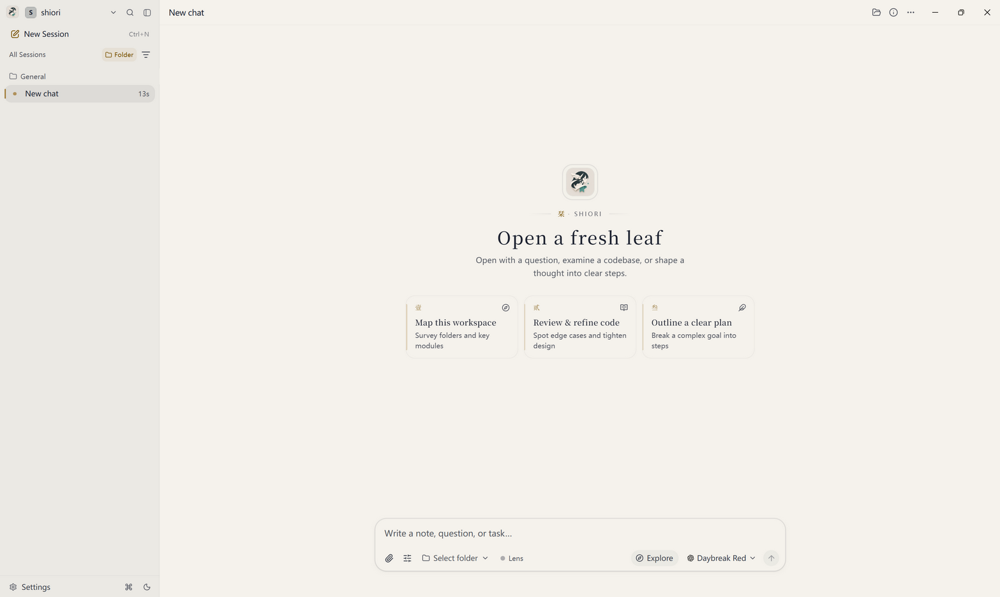
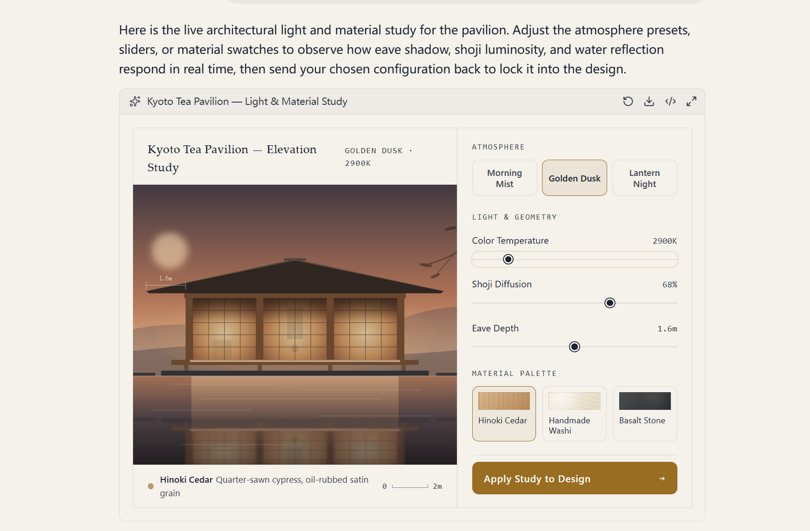

<div align="center">

# Shiori (栞)

**A local-first, aesthetic-driven desktop AI Agent studio.**

[English](README.md) · [简体中文](README.zh-CN.md)

[](LICENSE)
[](#installation)

</div>

<p align="center">
  
</p>

Shiori is an open-source desktop workspace for working with autonomous AI agents across your local projects, shell, documents, APIs, and MCP servers. It pairs a complete engineering-grade agent runtime with a calm, paper-inspired interface and three signature capabilities: **Creative Lens**, **Interactive UI Canvas (`shiori-ui`)**, and a **Zero-Cost Cloudflare Relay**.

---

## Core Agent Capabilities

Whether you are new to desktop AI agents or migrating from CLI tools, Shiori ships with a complete foundation out of the box:

- **Multi-Session & Project Workspaces** — Organize conversations by project folder, status, and labels, with isolated workspaces stored locally under `~/.shiori/`.
- **Local Code, Shell & File Execution** — Read, search, edit files, run terminal commands, and inspect workspace changes in a built-in **Git Diff drawer** without leaving the app.
- **Granular Permission Modes** — Switch instantly (`Shift + Tab`) between **Explore** (read-only), **Ask to Edit** (confirm before writes), **Guarded** (autonomous with risk checks), and **Execute** (full autonomy).
- **Mid-Turn Steering** — Guide or refine an agent's direction while it is still running, without cancelling the entire turn.
- **Multi-Provider Model Connections** — Connect Anthropic, OpenAI / ChatGPT OAuth (with live model discovery), OpenAI-compatible endpoints, or local models, and switch models per session.
- **MCP Servers, REST APIs & Local Folders** — Plug external tools and data sources into any session via structured setup dialogs (supporting HTTP/SSE, local Stdio commands, and one-click `mcpServers` JSON paste).
- **Reusable Skills & Automations** — Author `SKILL.md` instruction packs with built-in templates, schedule recurring automations, build persistent HTML **Pages**, and track multi-step work on the **Tasks** board.
- **Local-First & Privacy-Respecting** — All sessions, skills, and workspace configs stay on your machine under `~/.shiori/` with zero telemetry and no mandatory cloud backend.

---

## What Makes Shiori Distinct

### 1. Creative Lens
Switch the agent's thinking and aesthetic posture directly from the composer bar. Move seamlessly between **Precision Engineering** (crisp, verifiable diffs and diagnostics) and expressive lenses such as **Editorial & Poetic** or **Architectural Studio** — avoiding generic, watered-down output when writing, brainstorming, or designing.

### 2. Interactive UI Canvas (`shiori-ui`)
Instead of dumping static HTML files or walls of text, Shiori renders live, sandboxed `shiori-ui` interactive widgets directly inside the conversation. Every widget automatically inherits Shiori's light/dark theme tokens, supports **two-way state feedback** (`window.shiori.send` / `data-shiori-send`) so your clicks steer the next turn, and can be opened fullscreen or **exported as a standalone offline HTML file**.

<p align="center">
  
</p>

### 3. Zero-Cost Cloudflare Relay
Need to reach your desktop workspace securely from another device without paying for a VPS? Shiori includes a self-hostable **Cloudflare Workers + Durable Objects** relay under [`apps/relay`](apps/relay) engineered with strict Free-Plan safeguards (observability logs disabled, 4-client cap, 80k daily request guard) so you can tunnel to your local agent at zero cost.

---

## Installation

Prebuilt **Windows x64** binaries are verified and available on the [Releases](https://github.com/Edmine/Shiori/releases) page (macOS and Linux build scripts are included in the repository; community testing and feedback are welcome):

- **Installer (Recommended)**: `Shiori-Setup-*-x64.exe` — supports custom install paths and preserves `~/.shiori/` data on uninstall.
- **Portable Archive**: `Shiori-*-win-x64.zip` — extract and run directly.

> **Note on Windows SmartScreen:** Open-source personal builds are not commercially code-signed. If SmartScreen prompts on first launch, choose **More info → Run anyway**.

---

## Local Development & Build

**Prerequisites:** [Bun](https://bun.sh/) 1.3+ and Node.js 20+.

```bash
# Install dependencies
bun install

# Start Electron in development mode
bun run electron:dev

# Run type checks and CI validation
bun run typecheck:electron
bun run validate:ci

# Build Windows installer & portable zip
bun run electron:build:main
bun run electron:build:preload
bun run electron:build:renderer
cd apps/electron && bun scripts/copy-assets.ts
bun x electron-builder --win --x64
```

See [CONTRIBUTING.md](CONTRIBUTING.md) for architecture notes, i18n checks, and PR guidelines.

---

## License & Acknowledgments

Shiori is open-source software licensed under the **Apache License 2.0**. See [LICENSE](LICENSE) and [NOTICE](NOTICE) for full details.

We gratefully acknowledge the open-source projects and ecosystems that made Shiori possible:
- [Craft Agents](https://github.com/craft-ai-agents/craft-agents-oss) — foundational desktop agent architecture and open-source inspiration
- [Electron](https://www.electronjs.org/), [React](https://react.dev/), [Bun](https://bun.sh/), [Tailwind CSS](https://tailwindcss.com/), and [Radix UI](https://www.radix-ui.com/)
- [Model Context Protocol (MCP)](https://modelcontextprotocol.io/) and the broader open AI developer community

Shiori is an independent open-source project and is not affiliated with or endorsed by any upstream vendor.
