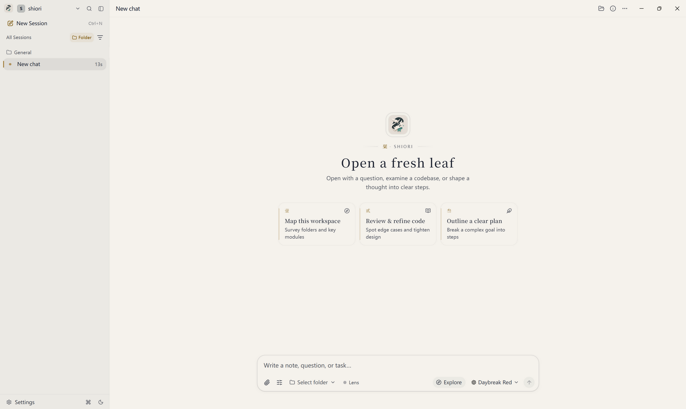
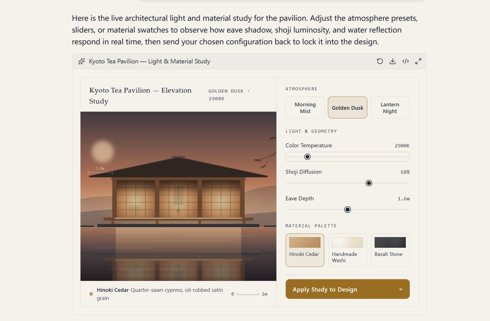

<div align="center">

# Shiori（栞）

**一个审美优先、本地掌控的桌面端 AI Agent 工作室。**

[English](README.md) · [简体中文](README.zh-CN.md)

[](LICENSE)
[](#安装与使用)

</div>

<p align="center">
  
</p>

Shiori 是一个开源桌面端 AI Agent 工作台，让你在本地代码仓库、终端、文档、API 与 MCP 服务之间与自主 Agent 高效协作。它既具备完整的工程级 Agent 基础能力，又以克制的纸墨视觉和三项核心创新——**创意透镜（Creative Lens）**、**交互画布（`shiori-ui`）** 与 **零成本 Cloudflare 中继（Cloudflare Relay）**——重塑桌面人机协作体验。

---

## 完整的 AI Agent 基础能力

无论你是第一次接触桌面 AI Agent，还是从命令行工具迁移过来，Shiori 都提供开箱即用的完整能力栈：

- **多会话与项目工作区**：按项目文件夹、状态与标签组织任务，所有会话与配置均隔离存储在本地 `~/.shiori/` 目录中。
- **本地代码、终端与文件操作**：支持检索、读写本地文件、执行命令行指令，并在内置的 **Git Diff 变更抽屉** 中随时审阅代码改动。
- **分级权限控制**：随时通过 `Shift + Tab` 在 **探索（只读）**、**编辑前询问**、**受保护执行** 与 **自动执行** 四种模式间切换，兼顾安全与效率。
- **运行中实时引导（Mid-Turn Steering）**：Agent 执行过程中可直接追加新指令纠偏，无需粗暴打断整轮任务。
- **多模型自由接入**：支持 Anthropic、OpenAI / ChatGPT OAuth（内置实时模型列表发现）、OpenAI 兼容接口及本地模型，可按会话灵活切换。
- **数据源（MCP / REST API / 本地文件夹）**：通过清晰的结构化弹窗一键接入远程 HTTP/SSE 或本地 Stdio MCP 服务（支持直接粘贴标准 `mcpServers` JSON 自动解析）、REST API 与本地目录。
- **技能（Skills）、自动化与任务看板**：通过表单与快捷模板创建可复用的 `SKILL.md` 指令集，支持定时/事件自动化、持久化 HTML **页面（Pages）** 与多步骤 **任务看板（Tasks）**。
- **本地优先与隐私可控**：零静默遥测、无强制云端依赖，你的数据始终掌握在自己手中。

---

## Shiori 的三大核心亮点

### 1. Creative Lens（创意透镜）
直接在输入框底栏切换 Agent 的思维与表达姿态——在需要严谨排错时保持**精密工程**模式，在写作、策划、视觉与概念探索时一键切入**编辑与诗意**或**建筑画室**等创意透镜，告别千篇一律的模板化回答。

### 2. Interactive UI Canvas（`shiori-ui` 交互画布）
不止于输出静态代码或大段文字：Shiori 能在对话流中直接渲染沙箱化的 `shiori-ui` 实时交互组件。每个组件自动同步 Shiori 的明暗主题配色，支持**双向交互回传**（`window.shiori.send` / `data-shiori-send`）让你的点击直接驱动下一轮对话，并支持全屏查看与**单文件离线 HTML 导出**。

<p align="center">
  
</p>

### 3. 零成本 Cloudflare Relay（远程中继）
想在其他设备上安全访问本机桌面工作区，又不想长期租用服务器？仓库内置基于 **Cloudflare Workers + Durable Objects** 的自建中继方案（位于 [`apps/relay`](apps/relay)），默认内置免费额度保护（关闭日志采集、最多 4 个并发客户端、每日 80,000 请求上限），零成本实现安全远程连接。

---

## 安装与使用

目前已完成 **Windows x64** 实机构建与验证（macOS / Linux 构建脚本已保留，欢迎社区测试反馈）：

- **安装版（推荐）**：前往 [Releases](https://github.com/Edmine/Shiori/releases) 下载 `Shiori-Setup-*-x64.exe`（支持自定义安装路径，卸载不会删除 `~/.shiori/` 数据）。
- **便携版**：下载 `Shiori-*-win-x64.zip`，解压即可运行。

> **关于 Windows SmartScreen 提示**：个人开源构建未附带商业代码签名，首次运行时如遇提示，点击「更多信息 → 仍要运行」即可。

---

## 本地开发与构建

环境要求：[Bun](https://bun.sh/) 1.3+、Node.js 20+。

```bash
# 安装依赖
bun install

# 启动开发环境
bun run electron:dev

# 类型检查与 CI 全量校验
bun run typecheck:electron
bun run validate:ci

# 打包 Windows 安装包与便携压缩包
bun run electron:build:main
bun run electron:build:preload
bun run electron:build:renderer
cd apps/electron && bun scripts/copy-assets.ts
bun x electron-builder --win --x64
```

更多开发规范与贡献方式请参阅 [CONTRIBUTING.md](CONTRIBUTING.md)。

---

## 开源协议与致谢

Shiori 基于 **Apache License 2.0** 协议开源，详见 [LICENSE](LICENSE) 与 [NOTICE](NOTICE)。

感谢以下优秀的开源项目与技术生态为 Shiori 提供了重要基石与灵感：
- [Craft Agents](https://github.com/craft-ai-agents/craft-agents-oss)（最初的桌面端 Agent 架构基础与开源启发）
- [Electron](https://www.electronjs.org/)、[React](https://react.dev/)、[Bun](https://bun.sh/)、[Tailwind CSS](https://tailwindcss.com/) 与 [Radix UI](https://www.radix-ui.com/)
- [Model Context Protocol (MCP)](https://modelcontextprotocol.io/) 与广大开源 AI 开发者社区

Shiori 是一个独立开源项目，与上述上游项目或厂商无隶属或背书关系。
